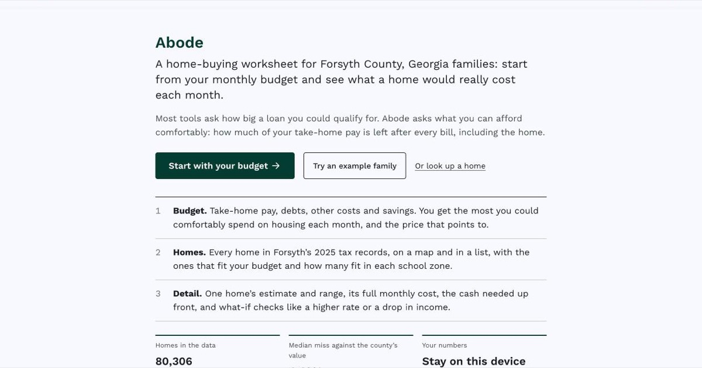

# Abode

A budget-first home planner for Forsyth County, GA. You enter your monthly take-home pay, debts, regular costs and savings, and it shows which homes fit and why a home is estimated at the price it is.



**Live site:** https://sahasreddye-sys.github.io/CAC26/

[](https://github.com/sahasreddye-sys/CAC26/actions/workflows/tests.yml)


## What it does

- **Budget.** You enter take-home pay, debts, other regular costs and savings (or press “try an example family”). It says how much you could spend on housing each month and still keep 20% of take-home pay, and the price that points to.
- **Homes.** Every Forsyth home in the 2025 tax records, on a map and in a list, with filters for size, year, lot, school zones and “fits my budget”. The list can be sorted by how close each home is to your budget.
- **Detail.** For one home: the estimate and its 80% range, the likely sale price, why the estimate is what it is, the full monthly cost (loan, tax, insurance, mortgage insurance, HOA dues), a comfort label, the cash needed up front, interest over the loan, and what-if sliders for the rate, the down payment and an income drop. Up to three homes can be compared side by side.
- **Sources.** Small (i) buttons next to each section explain where the numbers come from, how accurate the model is, and why the comfort cutoffs are what they are. Every rate shows its source and date.
- **Print.** A one-page worksheet with the budget, the home, the costs and the sources.
- **About** (`#/about`, linked in the footer): why it was built, who it's for, the model's accuracy as the notebook reports it, and its limits. Under the budget results there is a short glossary and a list of official places to get help.
- **Private.** Everything runs in the browser. Nothing you type is sent anywhere or saved. The only thing kept is the list of homes you add to compare (parcel IDs, in this browser's storage, with a clear button). The page loads files only from this site, and a shared compare link holds home IDs only.
- **Methods** (`#/methods`): estimate vs. county value, a fairness check by price and year built, the best and worst subdivisions, and a map of where the misses are biggest, all worked out from the estimates the site shows (`tools/build_error_tables.py`).

The planner is a learning project. It is not financial advice, a loan offer or an appraisal.

## The model

- **Data:** Forsyth County tax assessor parcel records, tax year 2025, and Forsyth County GIS school zones. `docs/data-sources.md` lists every file that was downloaded and which ones the site uses.
- **Model:** LightGBM, 600 trees, trained on log county value with 5-fold cross-validation.
- **What it predicts:** the county's assessed value, not what a home would sell for. There are no Forsyth sale prices in the open data, so estimates follow assessed value and not the market.
- **Notebooks:** `housing_model_v2.ipynb` is the current one. `Housing_Price_Model.ipynb` is the first version.

## How the site works

1. `housing_model_v2.ipynb` trains the models and saves them along with their accuracy numbers.
2. `data/forsyth.json.gz` holds every home (80,306), its estimate and lower/upper range, and the model's trees so the browser can explain an estimate. `data/summary.json` holds the accuracy numbers, including the 2025 sales check behind the likely sale price.
3. `planner-config.json` holds every rate, tax, insurance and program number, each with a source and a date.
4. `tools/build.py` copies the config and the accuracy numbers into `assets/site-data.js` and stamps a version on the script tags. Run it after editing the config or any file in `assets/`.
5. `index.html` loads those files and works everything out in the browser, so there is no server. The homes file downloads once the Budget screen is idle and is read when Homes or Detail opens.
6. `tools/build_school_zones.py` matches homes to school zones ahead of time.

## Repo layout

| Path | What is in it |
|---|---|
| `index.html` | The site (markup and styles) |
| `assets/` | The site's scripts: `planner-math.js` (budget math, tested), `budget-worksheet.js`, `app.js`, `screens.js`, `site-data.js` (made by `tools/build.py`), plus the font and icons |
| `planner-config.json` | Every rate and fee the planner uses, with sources |
| `NEEDS_OWNER.md` | Numbers that still need checking, and what was left out on purpose |
| `housing_model_v2.ipynb` | Current model training notebook |
| `Housing_Price_Model.ipynb` | First version of the notebook |
| `data/` | Home data, the in-browser model, school zones and accuracy numbers |
| `tools/` | `build.py` (site data and versions) and the school zone script |
| `tests/` | Tests for the budget math, the config and the data, run on every push by `.github/workflows/tests.yml` along with an HTML check (`.htmlvalidate.json`) |
| `docs/` | Data sources and notes on the loan payment calculation |
| `DESIGN.md` | Design notes for the site |

## Run it locally

```bash
git clone https://github.com/sahasreddye-sys/CAC26.git
cd CAC26
python -m http.server 8000
```

Then open http://localhost:8000. After changing `planner-config.json` or a script, run `python tools/build.py`. To run the tests, use `node --test` (Node 20 or newer, and Python 3 for the build check). To retrain, open `housing_model_v2.ipynb` in Jupyter or Colab and run the cells in order.

## Limits

- Estimates come from assessed values, not sale prices or a home's condition. The step to a likely sale price uses a ratio measured in Alpharetta, because Forsyth has no open sale records yet.
- Only Forsyth County homes are in the planner right now, and homes built after the 2025 tax roll are missing.
- The homestead exemption and the City of Cumming tax rate aren't applied yet (see `NEEDS_OWNER.md`).
- It can't check whether you qualify for a loan or a program.

## How it was built

The model, from the data cleaning to the validation, is my own work. The interface was built with help from AI coding tools, and AI helped look up the sources for the numbers in `planner-config.json`; each one is linked so it can be checked.

## License

MIT, see `LICENSE`.
